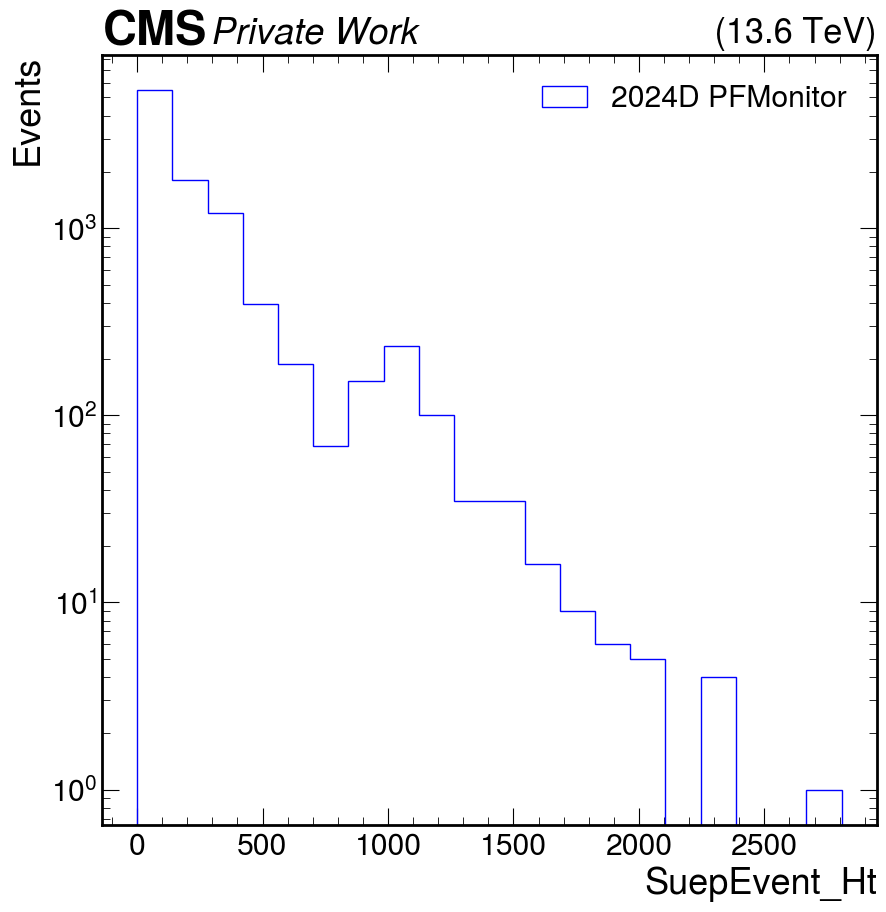
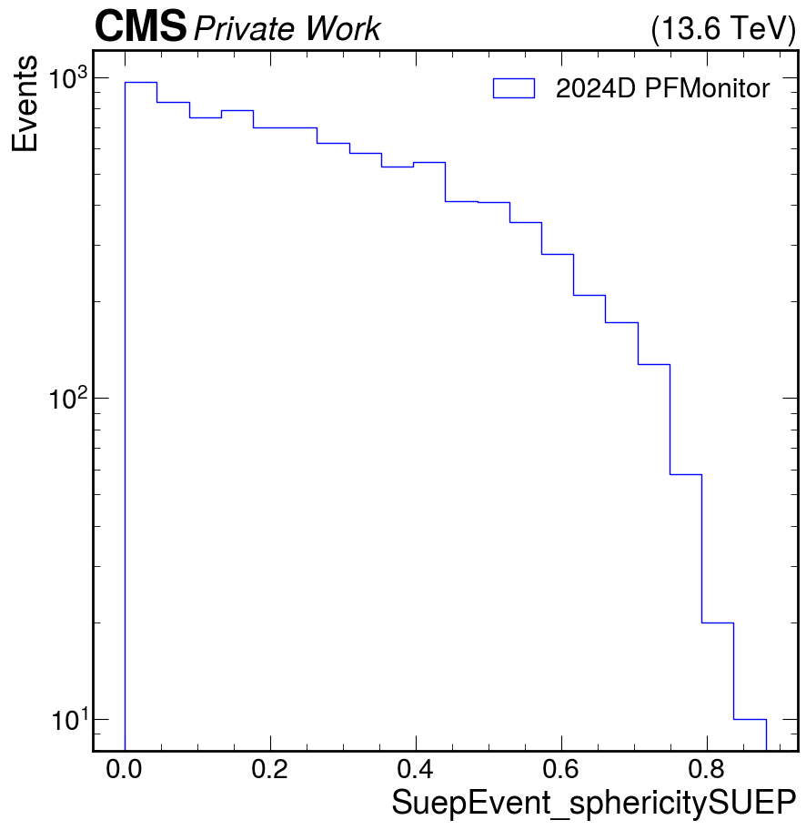

# SUEPTron

Produces Run 3 Scouting NanoAOD ntuples from ScoutingPFMonitor (MiniAOD) or ScoutingPFRun3 input, with additional branches for SUEP analyses. Supports 2024 and 2025 data and MC.

## Setup

Initialize environment and GRID:
```bash
source /cvmfs/cms.cern.ch/cmsset_default.sh
source /cvmfs/grid.cern.ch/alma9-ui-current/etc/profile.d/setup-alma9-test.sh
voms-proxy-init --rfc -voms cms --valid 192:00
```

Initialize CMSSW:
```bash
cmsrel CMSSW_16_0_3
cd CMSSW_16_0_3/src
cmsenv
```

Clone and build:
```bash
git clone https://github.com/SulaymanA/SUEPTron.git
scram b clean
scram b
```

## Options

| Parameter | Default | Description |
|---|---|---|
| `inputFile` | — | Input file path (prefix `file:` for local) |
| `outputFile` | `suepton.root` | Output NanoAOD filename |
| `numEvents` | `-1` | Number of events to process (`-1` = all) |
| `year` | `2024` | Data-taking year (`2024` or `2025`) |
| `isData` | `True` | `True` for data, `False` for MC |
| `fromMini` | `True` | `True` for ScoutingPFMonitor/MiniAOD, `False` for ScoutingPFRun3 |
| `goldenJSON` | — | Path to Golden JSON file for lumi masking (data only) |
| `saveTracks` | `False` | Save charged track table (pT>0.75, \|η\|<2.4) |
| `savePFCands` | `False` | Save full PF candidate table |
| `saveJets` | `False` | Save standard scouting AK4 jet table |
| `saveJetsRecluster` | `False` | Save reclustered AK4/AK8 jet tables with ParticleNet scores |
| `saveMuonVtx` | `False` | Save scouting muon-with-vertex table |
| `saveRechits` | `False` | Save ECAL/HCAL rechit table (2025E onwards) |
| `saveTriggerTable` | `False` | Save `TriggerTable` with `denominator` and `Ht_corrected` |
| `applyJEC` | `False` | Apply HLT JEC corrections inside `TriggerTable` producer |
| `jecFile` | — | Path to JEC JSON file (required when `applyJEC=True`) |
| `jecTag` | `Winter24HLT_V1_MC` | Tag name inside the JEC JSON file |

## Example Commands

**Minimal data run (ScoutingPFRun3, 2024):**
```bash
cmsRun SUEPTron/HLTSCOUTNANOProducer/python/process.py \
    inputFile=/store/data/Run2024D/ScoutingPFRun3/MINIAOD/PromptReco-v1/.../file.root \
    outputFile=out.root isData=True year=2024 fromMini=False numEvents=10
```

**ScoutingPFRun3 with trigger efficiency table and HLT JEC corrections:**
```bash
cmsRun SUEPTron/HLTSCOUTNANOProducer/python/process.py \
    inputFile=/store/data/Run2024D/ScoutingPFRun3/MINIAOD/PromptReco-v1/.../file.root \
    outputFile=out.root isData=True year=2024 fromMini=False \
    saveTriggerTable=True applyJEC=True \
    jecFile=SUEPTron/JEC/jetHLT_jerc.json jecTag=Winter24HLT_V1_MC
```

**Minimal data run (ScoutingPFMonitor, 2024):**
```bash
cmsRun SUEPTron/HLTSCOUTNANOProducer/python/process.py \
    inputFile=/store/data/Run2024D/ScoutingPFMonitor/MINIAOD/PromptReco-v1/000/380/306/00000/f2b70a80-5047-4b29-8d5b-18f83d927320.root \
    outputFile=out.root isData=True year=2024 numEvents=10
```

**ScoutingPFMonitor with tracks, PF candidates and Golden JSON lumi masking:**
```bash
cmsRun SUEPTron/HLTSCOUTNANOProducer/python/process.py \
    inputFile=/store/data/Run2024D/ScoutingPFMonitor/MINIAOD/PromptReco-v1/000/380/306/00000/f2b70a80-5047-4b29-8d5b-18f83d927320.root \
    outputFile=out.root isData=True year=2024 savePFCands=True saveTracks=True \
    goldenJSON=/path/to/Cert_Collisions2024_378981_386951_Golden.json
```

**ScoutingPFMonitor with trigger efficiency table and HLT JEC corrections:**
```bash
cmsRun SUEPTron/HLTSCOUTNANOProducer/python/process.py \
    inputFile=/store/data/Run2024D/ScoutingPFMonitor/MINIAOD/PromptReco-v1/000/380/306/00000/f2b70a80-5047-4b29-8d5b-18f83d927320.root \
    outputFile=out.root isData=True year=2024 \
    saveTriggerTable=True applyJEC=True \
    jecFile=SUEPTron/JEC/jetHLT_jerc.json jecTag=Winter24HLT_V1_MC
```

**MC (ScoutingPFMonitor MiniAOD, 2024):**
```bash
cmsRun SUEPTron/HLTSCOUTNANOProducer/python/process.py \
    inputFile=/store/mc/Run3Winter24MiniAOD/SUEP.../file.root \
    outputFile=out_mc.root isData=False year=2024 numEvents=10
```

**MC with gen-level collections, reclustered jets and HLT JEC corrections:**
```bash
cmsRun SUEPTron/HLTSCOUTNANOProducer/python/process.py \
    inputFile=/store/mc/Run3Winter24MiniAOD/SUEP.../file.root \
    outputFile=out_mc.root isData=False year=2024 \
    saveJetsRecluster=True saveTriggerTable=True applyJEC=True \
    jecFile=SUEPTron/JEC/jetHLT_jerc.json jecTag=Winter24HLT_V1_MC
```

## Output Tables

The output NanoAOD always contains:

- **`SuepEvent`** — per-event SUEP variables: sphericity, AK15 jet multiplicity/pT, HT, max lepton pT
- **`Track`** *(optional)* — charged PF candidates passing track selection
- **`TriggerTable`** *(optional)* — `denominator` flag and `Ht_corrected` from JEC-corrected jets after muon cleaning

Standard scouting tables (muons, electrons, photons, PF jets, MET, rho, reclustered AK4/AK8 with ParticleNet) are included via the standard `PhysicsTools.NanoAOD.custom_run3scouting_cff` sequence and can be enabled/disabled with the save flags above.

## Example Output

<p>
  
  
</p>
